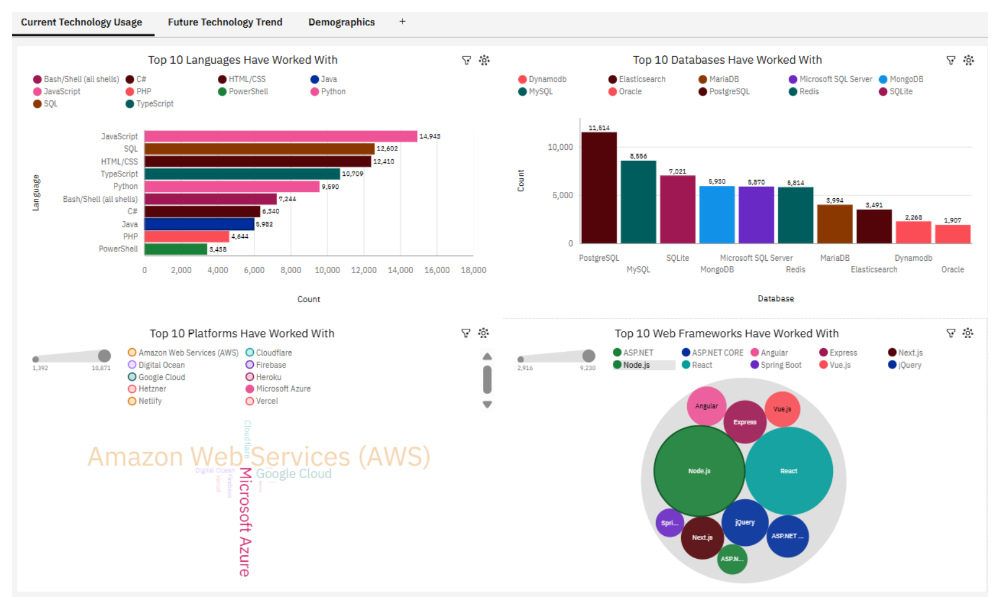

# Developer Technology Trends: What Developers Use Today and Want Next

An end-to-end data analysis project using the Stack Overflow Developer Survey, completed as the capstone of the IBM Data Analyst Professional Certificate. It covers data collection, cleaning, exploratory analysis, SQL, visualisation, an IBM Cognos Analytics dashboard and a final presentation.



## Business questions
- Which programming languages, databases, platforms and web frameworks do developers use today?
- Which ones do they want to use next?
- Who are the respondents (age, education, country)?

## Key findings
Counts below come from the Cognos dashboard (18,845 survey responses).

| Area | Finding |
|---|---|
| Languages used | JavaScript (14,943), SQL (12,602) and HTML/CSS (12,410) lead |
| Languages wanted | JavaScript (11,541), SQL (10,944) and TypeScript (10,437) lead |
| Rising languages | Rust (2,284 used to 5,597 wanted) and Go (3,305 to 5,661) enter the top 10 wanted; Java falls (5,982 to 4,048) |
| Databases | PostgreSQL is both the most used (11,514) and most wanted (12,193); MySQL falls from 8,556 to 6,204 |
| Cloud platforms | AWS leads current (10,871) and future (10,516) use, followed by Azure and Google Cloud |
| Respondents | 41.3% are aged 25-34 and 27.3% are 35-44; most come from the USA (3,441), Germany (1,339) and India (1,316) |

## Project workflow

| # | Notebook | What it does |
|---|---|---|
| 01 | `01_data_collection` | Collects job-posting counts by location and key skill through an API and saves them to Excel |
| 02 | `02_web_scraping` | Scrapes programming language salaries from a web page with BeautifulSoup |
| 03 | `03_explore_dataset` | First look at the survey: shape, data types, age and country counts |
| 04 | `04_finding_duplicates` | Finds duplicate rows and separates true duplicates from similar answers |
| 05 | `05_data_wrangling` | Removes duplicates, handles missing values and prepares compensation data |
| 06 | `06_finding_missing_values` | Counts and visualises missing values, then imputes one categorical column |
| 07 | `07_normalizing_data` | Min-Max scaling and Z-score standardisation of compensation |
| 08 | `08_data_wrangling_pipeline` | Standardises text, one-hot encodes employment, applies a log transform and builds an experience-level feature |
| 09 | `09_exploratory_data_analysis` | Job satisfaction, remote work, languages by country and education |
| 10 | `10_distribution_analysis` | Languages worked with vs wanted, remote work by country, correlation |
| 11 | `11_finding_outliers` | Detects compensation outliers (3 standard deviations and IQR) |
| 12 | `12_finding_correlation` | Compensation by country, and its correlation with experience and satisfaction |
| 13 | `13_data_visualisation` | Loads the data into SQLite, queries it with SQL and draws eight chart types |
| 14 | `14_visualisation_charts` | Charts for the capstone questions (languages, databases, respondents, compensation) |

## Dashboard
Built in IBM Cognos Analytics with three tabs: **Current Technology Usage**, **Future Technology Trend** and **Demographics**. Cognos needs a login, so the dashboard is saved here as images and a PDF.

- [Tab 1: Current technology usage](dashboard/01_current_technology_usage.png)
- [Tab 2: Future technology trend](dashboard/02_future_technology_trend.png)
- [Tab 3: Demographics](dashboard/03_demographics.png)
- [Full dashboard (PDF)](dashboard/survey_dashboard.pdf)

## Presentation
[Developer Technology Trends (PDF)](presentation/developer_technology_trends.pdf): executive summary, methodology, results, findings and implications, and conclusion.

## Data
| Source | Used for |
|---|---|
| Stack Overflow Developer Survey, full file (65,437 responses) | Notebooks 03 to 14 |
| Survey extract provided with the course (18,845 responses, mostly professional developers) | Cognos dashboard |
| Jobs dataset provided with the course | Notebook 01 |
| Static course web page of language salaries | Notebook 02 (figures are illustrative) |

The notebooks load the survey from course-provided URLs, so the large survey files are not stored in this repo. Small outputs are in [`data/`](data/): `job-postings.xlsx`, `job-postings-skills.xlsx` and `popular-languages.csv`.

## Data-quality decisions
- **Duplicates:** removed exact duplicate rows. Respondents who only shared answers on a few columns were kept, because they are different people.
- **Compensation:** about 64% of respondents did not report it. I did not fill the gaps with the median, because that would invent a salary for most rows. Compensation analysis uses only respondents who reported pay.
- **Outliers:** removed with the IQR method among respondents who reported pay (978 of 23,435).
- **Currency:** analysis uses `ConvertedCompYearly` (USD), not `CompTotal`, which mixes currencies.
- **Age:** recorded as ranges, so a numeric age is an approximate midpoint.

## Limitations
- The survey shows what developers say they use and want, which is not the same as employer demand.
- Most respondents are aged 25-44, so findings may not describe all developers.
- The dashboard uses a smaller extract than the notebooks, so its counts are lower. The rankings agree, for example PostgreSQL leads databases in both.
- The data covers one survey year, so these are not long-term trends.

## Tools
Python (Pandas, NumPy, Matplotlib, Seaborn, Requests, BeautifulSoup, openpyxl) | SQL (SQLite) | IBM Cognos Analytics | Jupyter Notebooks and Google Colab

## Run the notebooks
1. Open [Google Colab](https://colab.research.google.com) and choose **File > Upload notebook**.
2. Select a notebook from `notebooks/` and choose **Runtime > Run all**. An internet connection is needed to download the data.

## Repository structure
```
notebooks/       14 Jupyter notebooks, in project order
data/            small output files from the data collection stage
dashboard/       Cognos dashboard images and PDF
presentation/    final presentation (PDF)
```

## Author
**Anandu Priyakumar** | [LinkedIn](https://linkedin.com/in/ananpkumar) | [GitHub](https://github.com/ananpkumar)

*Independent portfolio project completed during the IBM Data Analyst Professional Certificate. Survey data belongs to Stack Overflow and course datasets are provided by the course.*
